<p align="center">
  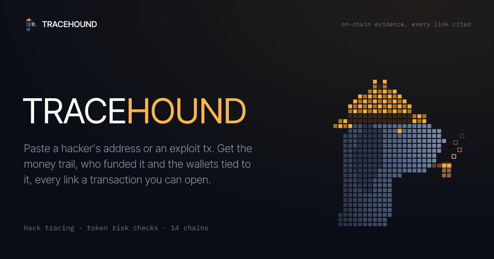
</p>

<h3 align="center">Follow the money. Every link a transaction you can open.</h3>

<p align="center">
  Paste a hacker's address or an exploit transaction and get the money trail, who funded the attacker<br/>
  and the wallets tied to them, in minutes instead of hours of clicking through explorers.
</p>

<p align="center">
  <a href="https://tracehound.pro"></a>
  
  
  
  
</p>

<p align="center">
  <a href="#-the-trace">The trace</a> ·
  <a href="#-token-check">Token check</a> ·
  <a href="#-pump-rings">Rings</a> ·
  <a href="#-share-cards">Share cards</a> ·
  <a href="#-how-it-works">How it works</a> ·
  <a href="#-quick-start">Quick start</a> ·
  <a href="docs/GUIDE.md">Full guide</a>
</p>

<br/>

<p align="center">
  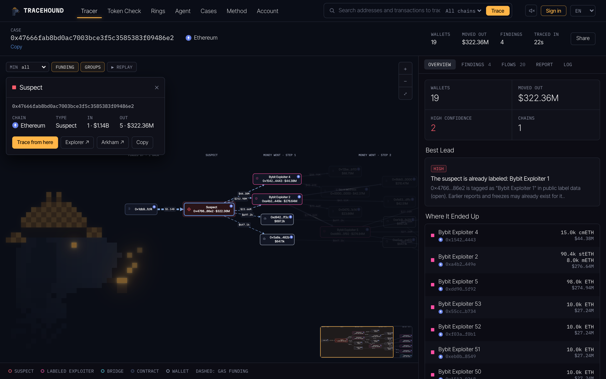
</p>

<br/>

## 🔎 The trace

One address or one transaction hash in, a case out. Tracehound walks the chain in both directions and keeps only what an investigator would write down.

<table>
  <tr>
    <td width="50%" valign="top">

**Funding source.** Who paid the attacker's first gas, followed back until an exchange withdrawal, a mixer or a bridge.

**Money trail.** Where the stolen funds went, hop by hop, ranked by share, with the USD value at the time each flow moved.

**Through swaps and pools.** A DEX swap paid to a fresh wallet is followed through; liquidity positions handed to another wallet are linked.

**Across chains.** THORChain, Wormhole, Mayan, deBridge, Across, Stargate, LayerZero OFT tokens and Circle's CCTP: what went in is matched to what came out on the other side, and the trace continues there.

**What it means.** Exchange deposit addresses that can be frozen, sibling wallets of the same operator, known exploiters on the path, loot that returns to the funder.

  </td>
    <td width="50%" valign="top">
      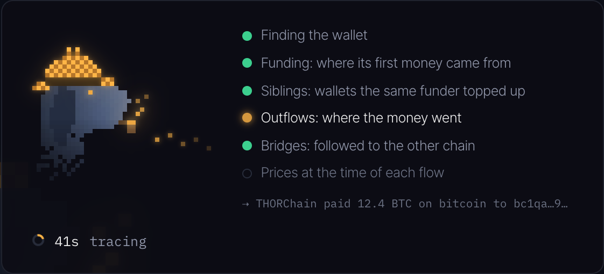
      <br/><br/>
      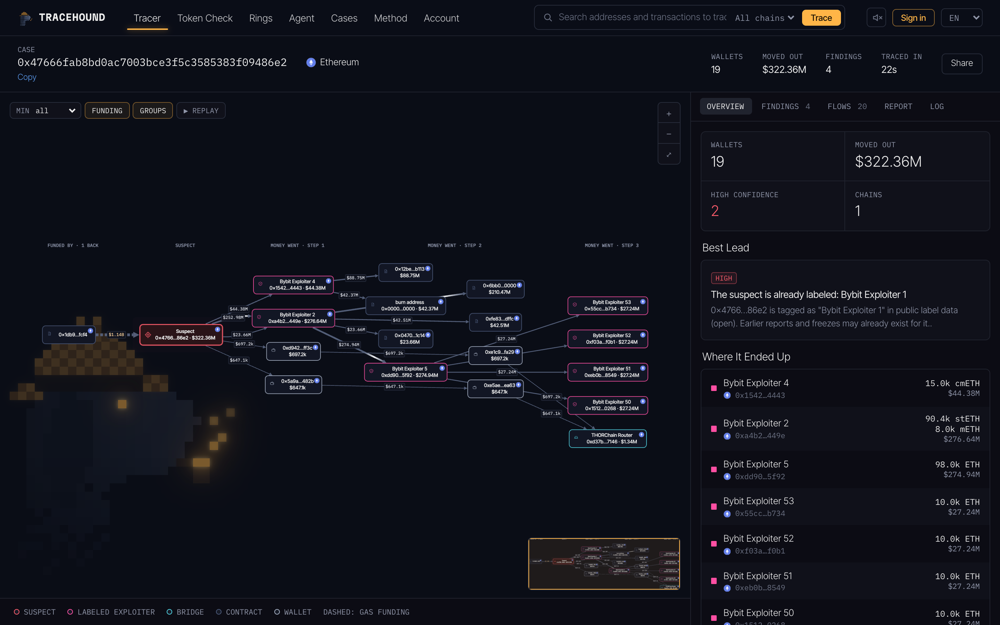
    </td>
  </tr>
</table>

> Every link between two wallets points to the transaction that created it. Tracehound does not guess who anyone is.

<br/>

## 🧪 Token check

A risk score for any token on **Solana**, **Base** or **BSC**, built from what the chain shows about the people behind it.

<p align="center">
  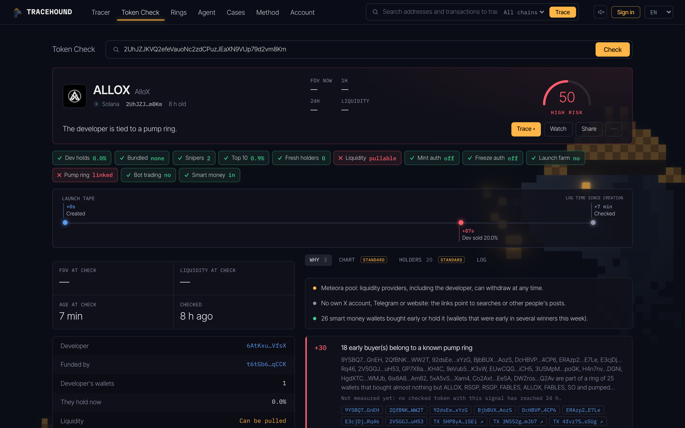
</p>

| Signal | What it looks at |
|---|---|
| 👤 **Developer** | First funding, past launches of the developer's circle, how many are dead, whether they already sold |
| 🎯 **Launch** | Bundled buys, snipers in the first slots, fresh wallets among the top holders |
| 🕸️ **Rings** | Early buyers and holders that belong to a known pump ring, launches that follow a ring's playbook |
| 💧 **Liquidity** | Pools that can be pulled, mint and freeze authorities, supply concentration |
| 🤖 **Trading** | Round-trip volume from bots, socials reused from earlier tokens |

Every reason links to its wallets and transactions, and each signal shows how often it was followed by an 80% drop within a day.

<br/>

## 🕸️ Pump rings

Wallets that buy the same launches together are clustered into rings, each with its funders, its launch playbook and how its tokens ended. A live watch follows ring wallets and alerts on new ring-style launches.

<p align="center">
  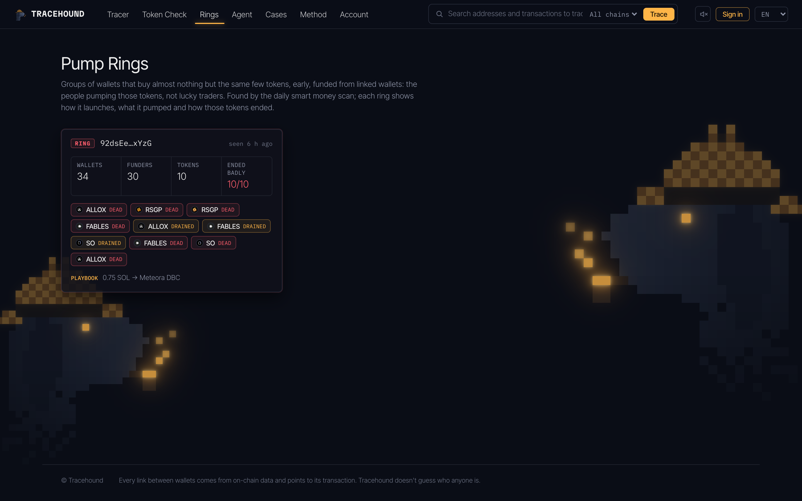
</p>

<br/>

## 🖼️ Share cards

Every case and token check comes with a card for X, Telegram and Discord, drawn on the server, so a shared link carries its verdict.

<p align="center">
  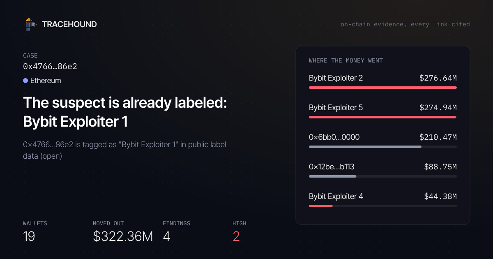
  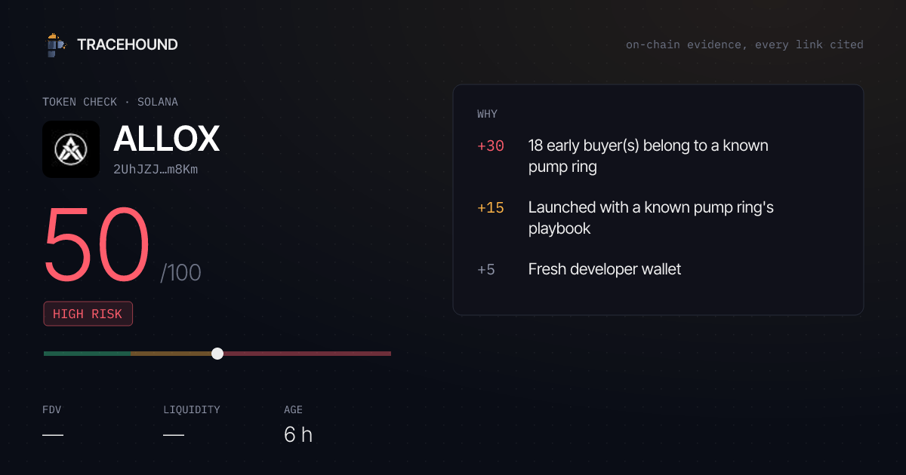
</p>

<br/>

## 📱 On the phone

<p align="center">
  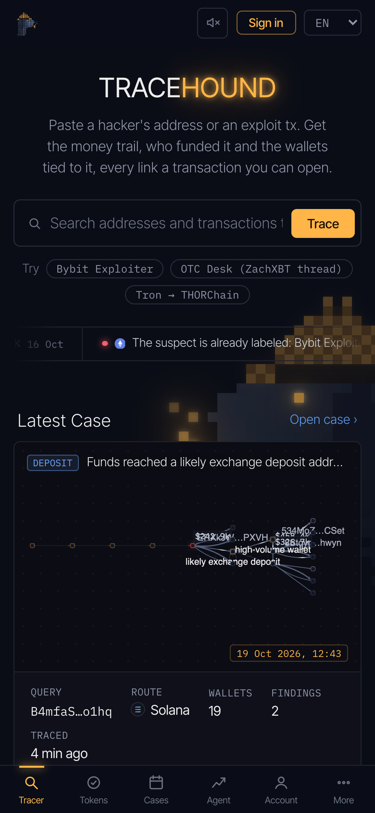
  &nbsp;
  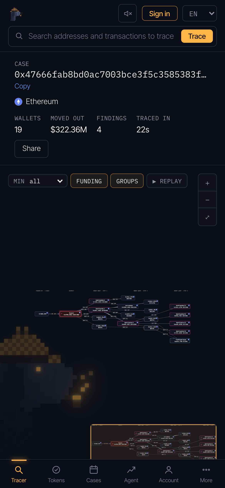
  &nbsp;
  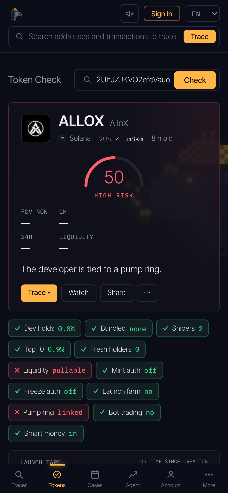
</p>

<br/>

## ⛓️ Coverage

| | Chains | Source |
|---|---|---|
| **Traced** | Ethereum · Base · Arbitrum · Optimism · BSC · Polygon | Etherscan v2 |
| | Solana | Helius |
| | Tron | TronGrid |
| | Bitcoin | mempool.space |
| **Exit only** | Litecoin · Dogecoin · Bitcoin Cash · Avalanche · XRP | THORChain Midgard |

USD values come from DefiLlama at the time each flow moved. Exchange wallets come from public label sets and the exchanges' own proof-of-reserves reports.

<br/>

## ⚙️ How it works

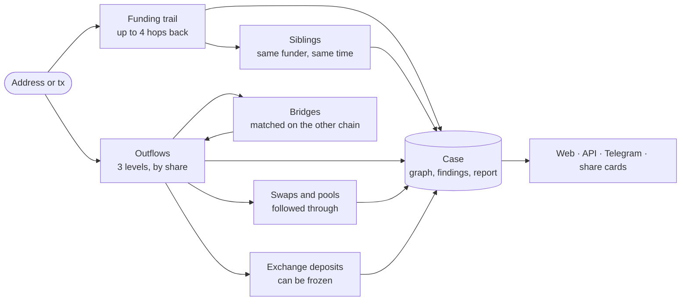

<br/>

## 🚀 Quick start

```bash
git clone https://github.com/localminimaa/tracehound.git
cd tracehound
cp .env.example .env      # HELIUS_API_KEY, ETHERSCAN_API_KEY (TronGrid and Bitcoin work without keys)
npm install
npm start                 # http://localhost:8787
```

A fresh install starts with a demo set of traced hacks, token checks and a pump ring, so the pages are full on the first run.

```bash
npm run trace -- 0x47666fab8bd0ac7003bce3f5c3585383f09486e2   # trace from the terminal
npm run token -- <mint>                                       # token check from the terminal
npm run regress                                               # known hacks and tokens, recorded answers, ~10 s
```

<br/>

## 🔌 Public API

```bash
curl -H "Authorization: Bearer th_..." https://<host>/api/v1/token/<address>
curl -H "Authorization: Bearer th_..." https://<host>/api/v1/trace?q=<address-or-tx>
```

`/api/v1/token`, `trace`, `check`, `case`, `alerts` and `usage`, with keys made on the account page. Details in the [guide](docs/GUIDE.md#public-api).

<br/>

## 🧱 Built with

<p>
  
  
  
  
  
  
</p>

No framework on the page: one HTML file, one script, one stylesheet. No build step on the server: Node runs the TypeScript directly.

<br/>

---

<p align="center">
  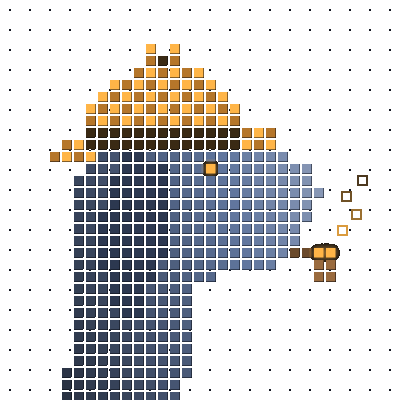<br/>
  <sub>Made by <a href="https://github.com/localminimaa">localminimaa</a></sub>
</p>
